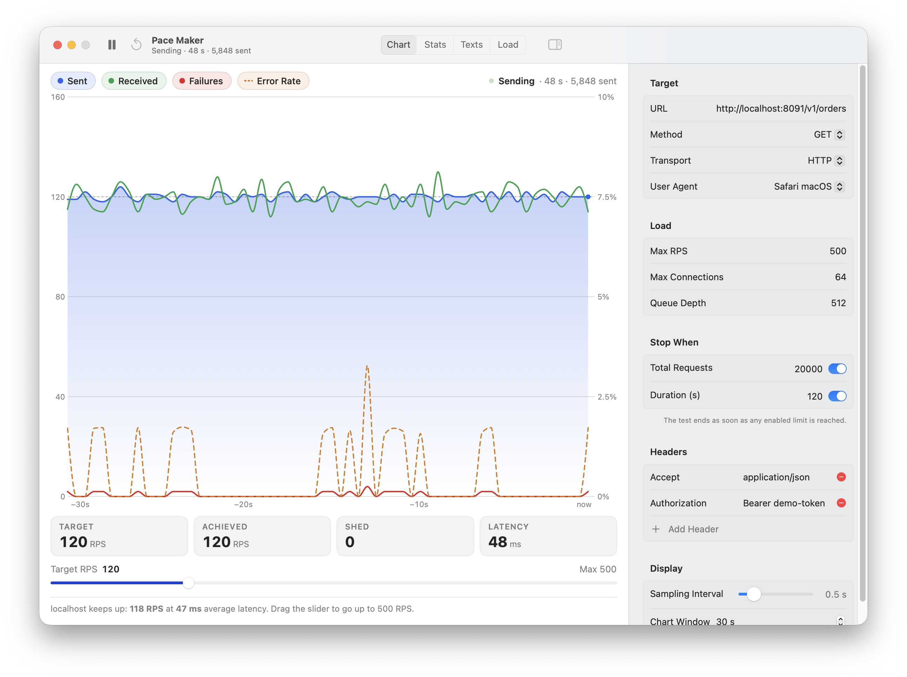
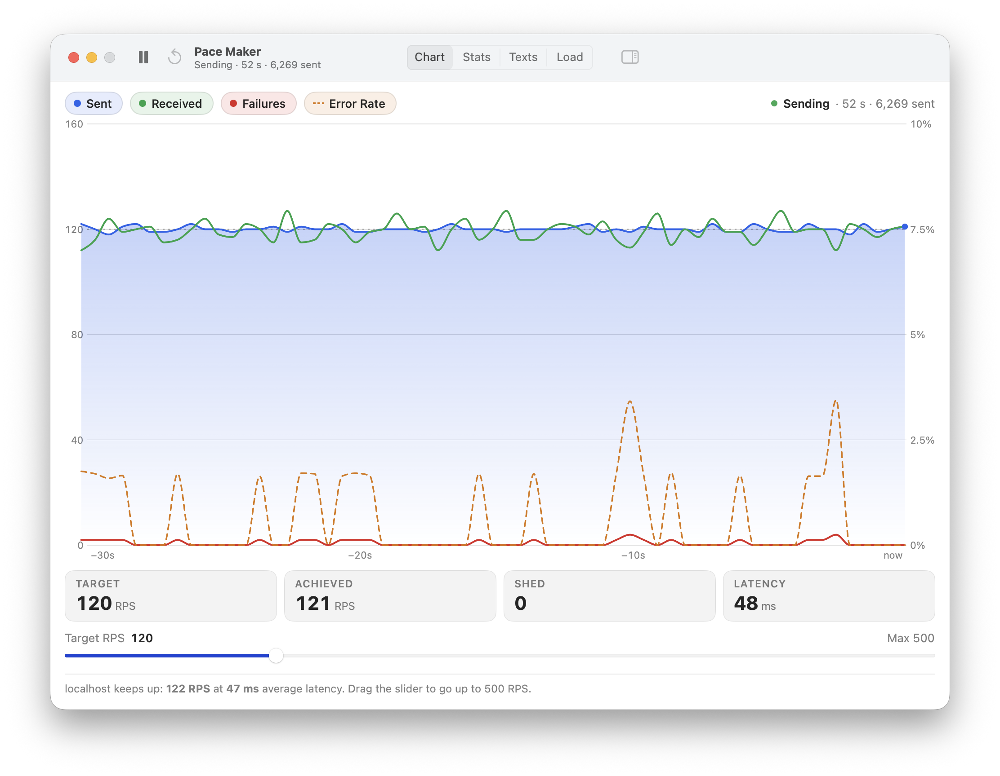
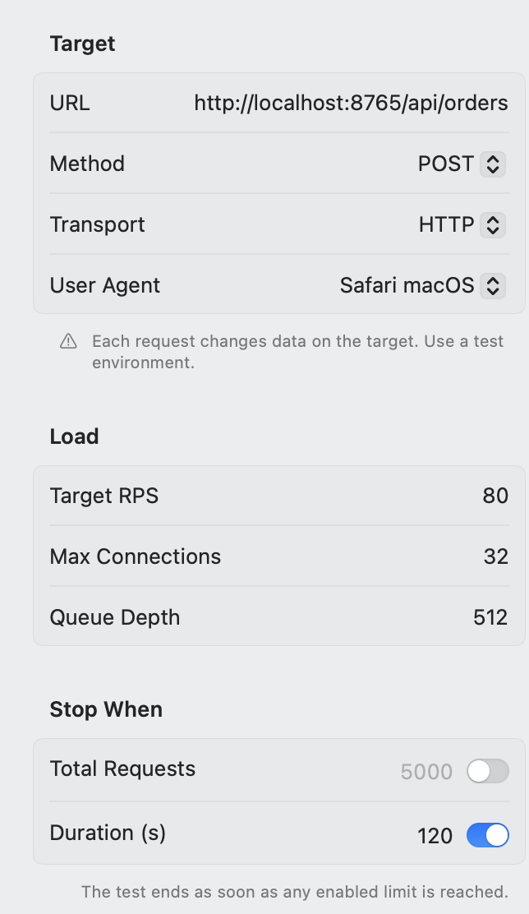
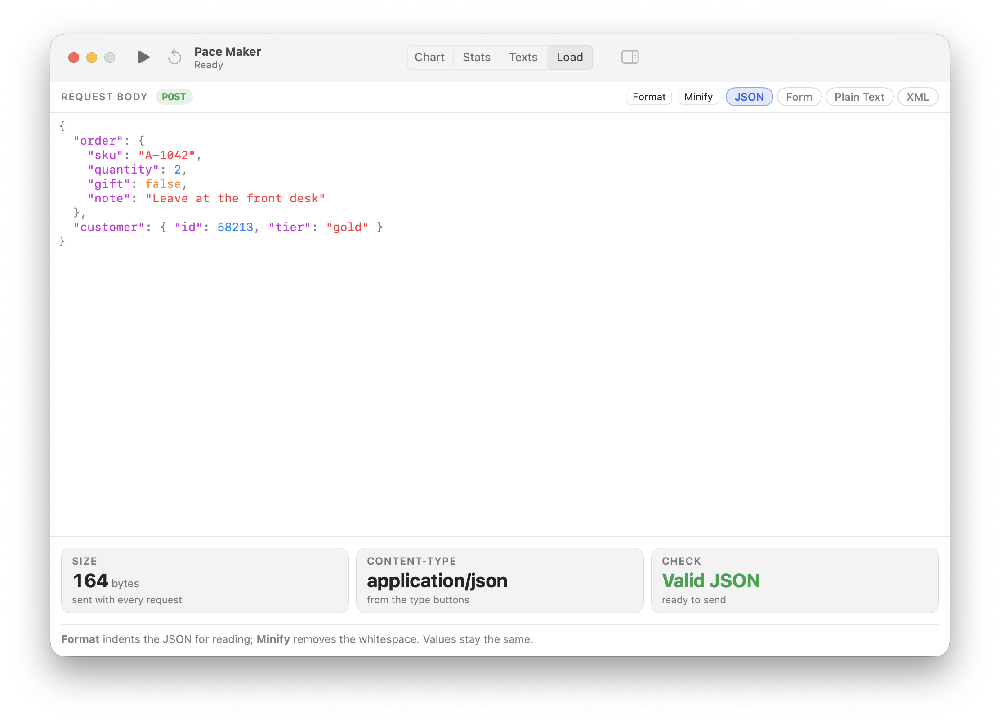
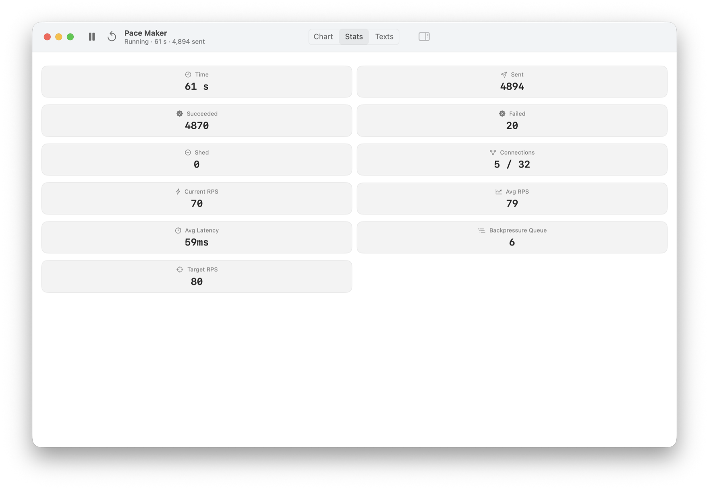
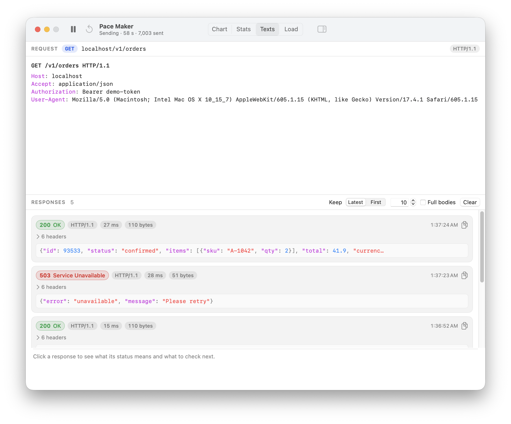
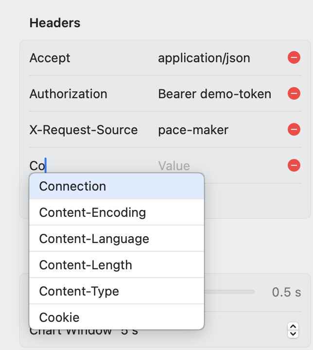

# Pace Maker v.14.1

Native HTTP load testing for macOS — fire configurable traffic with any HTTP method at any endpoint and watch it respond in real time.

## What is Pace Maker?

Pace Maker is a lightweight, fully native macOS app for putting HTTP endpoints under load. Point it at a URL, set how hard you want to push, and hit **Start**. Requests fire at your target rate while a live chart plots throughput, successes, failures, and error rate second by second. No browser tab, no YAML config, no Docker — just a clean desktop tool that does one thing well.

Built entirely in **Swift and SwiftUI** with structured concurrency under the hood, Pace Maker runs as a real macOS app, not a cross-platform wrapper.

## Why Pace Maker?

- **Real-time visibility.** A live Swift Charts graph shows sent vs. received throughput, failures, and error rate as the test runs — not a summary report after the fact.
- **Honest backpressure.** When your target is faster than the endpoint can answer, Pace Maker _shows_ the achieved rate dropping instead of silently buffering forever. That dip is the signal you actually want.
- **Inspect every exchange.** A built-in request/response viewer shows exactly what's going over the wire, with sliding-window history and optional truncation.
- **Native feel.** A Liquid Glass toolbar, a settings inspector, keyboard shortcuts, header autocomplete, and settings that are remembered between launches. It behaves like a Mac app because it is one.

## Key Features

### 📈 Live chart — four series, fully interactive

The chart plots **Sent**, **Received**, **Failures**, and **Error Rate** as separate series and scrolls smoothly while the test runs. Error Rate has its own percentage axis on the right, and a dashed line marks the target rate. Click any legend pill to toggle a series on or off, drag the chart to pan back through time, and set the visible window from 5 seconds up to 5 minutes.

Around the chart:
- A **status line** shows whether the test is ready, sending, paused, or finished, with the elapsed time and sent count.
- **Readouts** show the target rate, the achieved rate, shed requests, and average latency.
- A **rate slider** changes the request rate live, from 1 up to the **Max RPS** set in Settings.
- A **hint line** explains what you're seeing and what to try next — for example, when the server can't keep up and requests are being shed. It changes only when something significant happens, at most every 3 seconds.

### ⚙️ Settings inspector — dial in exactly how hard to push

Every setting lives in one native inspector beside the chart: the target URL, **HTTP method** and User-Agent preset; the **Max RPS** (the slider under the chart sets the live rate up to it), maximum connections and backpressure queue depth; and stop conditions — total requests, a duration, or both. Toggle it from the toolbar; your last configuration is remembered between launches.

Changes under **Load**, **Stop When**, **Headers**, and **Display** apply to a running test straight away — no restart needed. New headers go out with the requests sent after the change, and lowering a stop condition below what's already done ends the test.

Pick any method — **GET, HEAD, POST, PUT, PATCH, DELETE, or OPTIONS**. Methods that change data show a reminder to point them at a test environment.

### ✍️ Load — compose the request body

The **Load** tab, next to Chart, Stats, and Texts, holds the body sent with every POST, PUT, PATCH, or DELETE request. Pick a content type (JSON, form, plain text, or XML) and write the body in a roomy monospaced editor with **JSON and XML syntax highlighting** that keeps your quotes and dashes exactly as typed.

- **Format** and **Minify** tidy up JSON in one click.
- Readouts show the body's size, the Content-Type that will be sent, and whether the body is well-formed — with the line and column of any JSON or XML error.
- A tip line explains what to do next, and edits reach a running test straight away.
- A Content-Type you set under Headers takes precedence. For GET, HEAD, and OPTIONS the tab explains that no body is sent and offers a one-click switch to POST.

### 📊 Stats — the numbers that matter

Every number of the test, grouped by what it describes:

- **Progress** — bars for the stop conditions and an estimated finish time.
- **Throughput** — current, average, and peak RPS, the target, and how much of it is achieved.
- **Responses** — received, failed, success rate, and shed requests, plus a status-code breakdown (2xx / 3xx / 4xx / 5xx / no response) with the most common codes.
- **Latency** — average, p50, p90, p99, fastest, and slowest, with a spread strip on a log scale.
- **Connection & data** — connections and queue in use, the negotiated protocol (HTTP/1.1, HTTP/2, HTTP/3), data received, data rate, and average response size.

Click any metric to see what it means, how it's measured, and what its current value tells you.

### 🔍 Request & response viewer

The **Texts** tab shows the exact request being fired — method, URL, protocol, coloured headers, and a highlighted body — and previews your current settings when no test is running.

Responses arrive newest first as cards with a status badge, protocol, latency, and size; headers fold away, bodies are highlighted, and one click copies a whole response. Requests that got no response appear as red cards with the reason. Keep the latest or the first responses, choose how many, and switch between short and full bodies. Click a response to see what its status code means and what to check next.

### 🧩 Header editor with autocomplete

Add, edit, and remove request headers right in the inspector. Header-name fields autocomplete against the standard HTTP request header set as you type.

### 🎛️ Full control, always one click away

Start, pause, resume, and reset from the window toolbar — or from the **Test** menu with **⌘R** and **⇧⌘R**. Pausing and then resuming continues with whatever time and requests are left. On macOS 26 and later the toolbar uses Liquid Glass, and on macOS 27 the view switcher uses the new tab style.

## How it works under the hood

Pace Maker is built on Swift structured concurrency end to end:

- A **token-bucket pacer** releases requests at exactly your target rate, never blocking on a response, into a bounded backlog served by a fixed pool of workers — nothing is spawned per request, so memory stays flat at any throughput.
- An **adaptive connection gate** sizes how many requests are in flight from observed latency and backs off when the server saturates. When every connection is busy, requests wait in the backlog; when the backlog is full, excess requests are **shed** rather than buffered indefinitely.
- Per-request outcomes are recorded into lock-protected counters without suspending, and a sampler reads them each sampling interval to drive the live chart and stats.

The result: when an endpoint can't keep up, you see the achieved RPS honestly drop below target instead of getting a misleading "everything's fine" reading.

## Roadmap

HTTP load testing ships today. The architecture is already protocol-agnostic, with these transports on the way:

- **gRPC** endpoint testing
- **WebSocket** load
- **Raw TCP** load

## Requirements

- **macOS 14** or later (Liquid Glass on macOS 26+, tab-style view switcher on macOS 27)
- A Mac with **Apple Silicon** — release builds are arm64

## Getting started

1. [Download the latest release](https://github.com/eugenezimin/Pace-Maker/releases/latest) and open **Pace Maker**.
2. Enter a target URL in the settings inspector.
3. Choose the HTTP method, then set your Max RPS and maximum connections. For POST, PUT, PATCH, or DELETE, write the body in the **Load** tab.
4. Choose a stop condition — total requests, a duration, or both.
5. Press **Start** (⌘R) and watch the chart.

## About

Pace Maker is created by **Eugene Zimin**. 🔗 [github.com/eugenezimin](https://github.com/eugenezimin)

© 2026 Eugene Zimin. All rights reserved.

